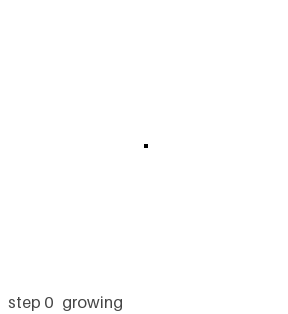
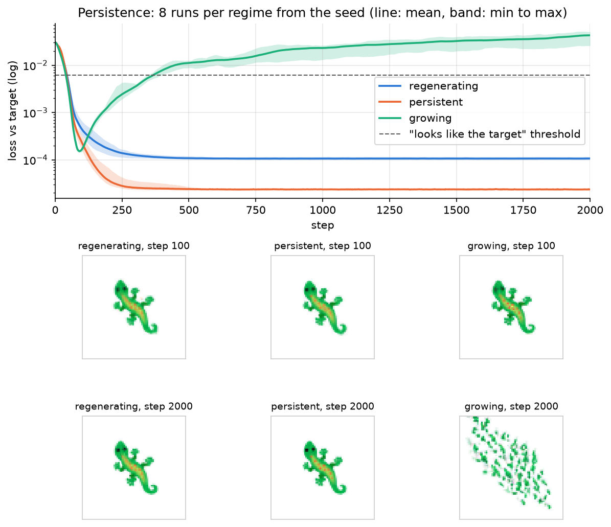
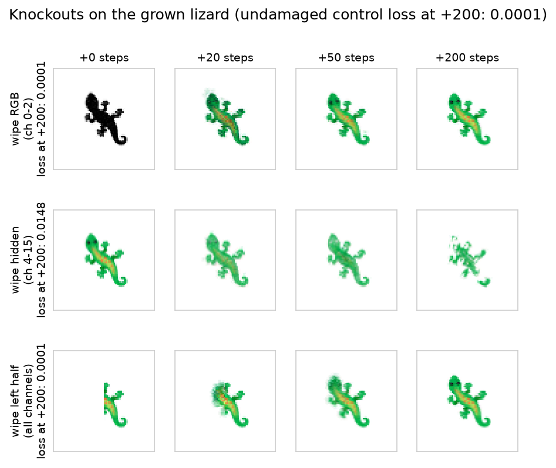

# Neural cellular automata — a lizard that grows back



**[Try it in your browser.](https://menzer-david.github.io/neural-cellular-automata/demo/)** Drag across the lizard to cut it and watch it grow back.

## What it is

A tiny neural network (8,320 weights) that runs inside every pixel of a 72x72 grid. Each pixel can only see its 8 neighbors, but starting from a single pixel they grow a lizard emoji together, and if you cut a piece off, they grow it back.

The idea comes from a 2020 paper called [Growing Neural Cellular Automata](https://distill.pub/2020/growing-ca/) by Mordvintsev et al. I rebuilt it in PyTorch, ran my own experiments on how well it heals, and wrote the browser demo from scratch in plain JavaScript.

## Why I built it

After my [random forest digit classifier](https://github.com/menzer-david/mnist-random-forest) I started learning how neural networks actually train by building backprop from scratch with Karpathy's micrograd. I wanted a project where you could actually see the neural network working instead of just getting an accuracy number at the end. The idea that one tiny network copied into every pixel could build a shape and repair it, kind of like cells in your body, was too cool not to try.

## How it works

Every pixel stores 16 numbers. 4 of them are its color and the other 12 are hidden numbers the pixels use to talk to each other. Each step, every pixel looks at its own numbers and its neighbors' numbers, runs them through the network, and updates itself. Only a random half of the pixels update each step, so nothing is in sync.

To train it, I start from one pixel, run 64 to 96 steps, compare the result to the lizard, and backprop through every step. I trained three versions for 3,000 iterations each on my M1 MacBook:

1. Growing: always starts from one pixel, so it only learns to grow.
2. Persistent: keeps running lizards that are already grown, so it also has to stay a lizard.
3. Regenerating: same as persistent, but I cut random holes in them during training.

## Results

The growing version looks perfect at around step 90 and then falls apart. By step 2,000 it's just scattered pixels, and it actually scores worse than an empty grid. The other two still look like the lizard in 8 out of 8 runs.



Then I cut holes of different sizes into each version, 20 times per size, and checked how often it healed within 300 steps.

| Hole radius (px) | 3 | 6 | 9 | 12 | 15 | 18 |
|---|---|---|---|---|---|---|
| Regenerating | **95%** | **90%** | **70%** | 30% | 35% | 15% |
| Persistent | 60% | 45% | 25% | 10% | 0% | 0% |
| Growing | 5% | 0% | 0% | 0% | 5% | 0% |

Only the version that practiced getting cut can really heal. Same network, same amount of training, completely different behavior.

The weirdest result was the knockout test. When I wiped all the color off a grown lizard but left the hidden numbers, it turned black and then repainted itself in 8 out of 8 runs. When I did the opposite and wiped only the hidden numbers, it looked perfect at first and then fell apart in 8 out of 8 runs. The plan for the lizard isn't stored in the colors at all. It's in the hidden numbers.



I also trained a butterfly and a mushroom. My first try only gave them 2,000 iterations and they slowly fell apart, because the learning rate drops at iteration 2,000 and they stopped right before it mattered. At 3,000 they hold up fine.

## How to run it

```
pip install -r requirements.txt
python3 test_nca.py         # quick check that everything works
python3 nca.py train --target lizard --regime regenerating --iters 3000 --out checkpoints/lizard.pt
python3 experiments.py      # remakes every figure in figures/
```

The trained models are already in `checkpoints/`, so you don't need to retrain anything. Training takes about an hour per model on an M1. To grow your own image, put a transparent PNG in `targets/` and pass `--target <name>`. Simple shapes like emoji work best.

## What I learned

The biggest thing I learned is that what you train a model on matters as much as the model itself. In addition, I learned that backprop through 80 steps is the same chain rule I built in micrograd, just repeated, but it used so much memory that my 8 GB Mac started swapping. Gradient checkpointing fixed that by recomputing steps during the backward pass instead of storing them all. I also learned to keep my charger plugged in, because my battery died at 1% halfway through training. Overall this project showed me that you don't need one big brain to build something complicated. A lot of small ones following the same rule can do it too.

## Credits

The method is from [Growing Neural Cellular Automata](https://distill.pub/2020/growing-ca/) by Mordvintsev, Randazzo, Niklasson and Levin (Distill, 2020). The emoji images are from Google's [Noto Emoji](https://github.com/googlefonts/noto-emoji), and their license is in `targets/LICENSE`.
