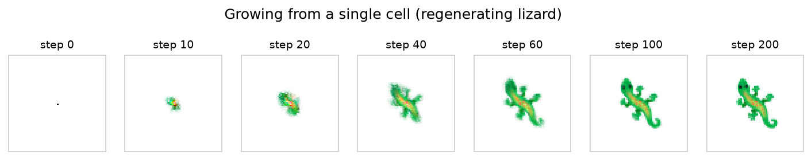
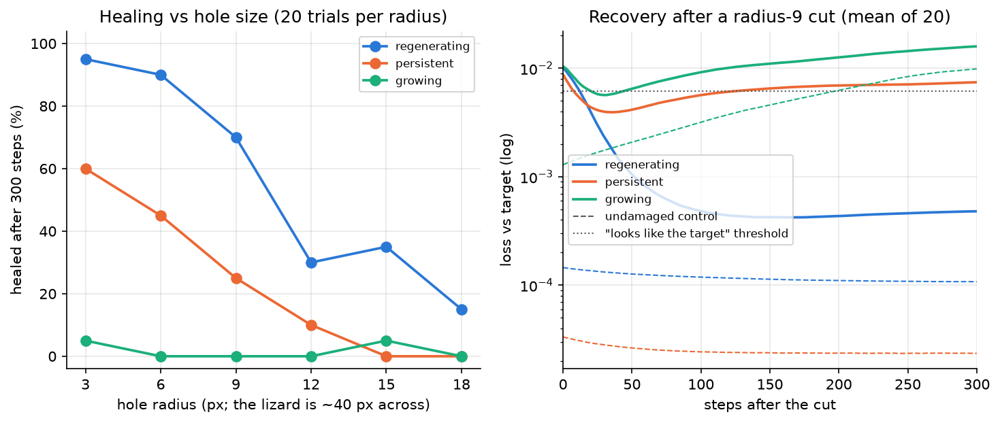
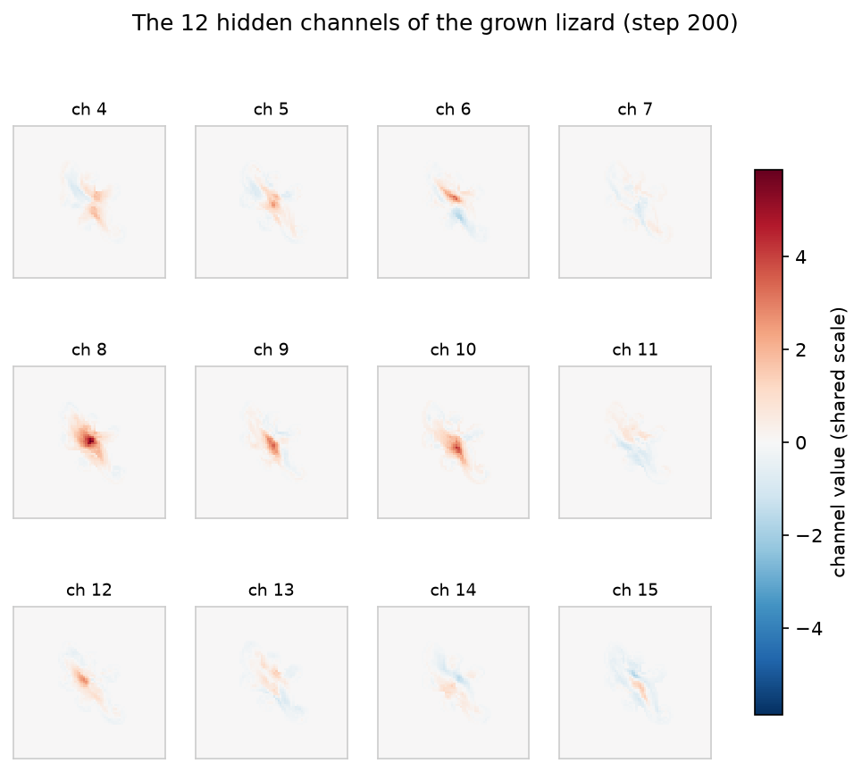
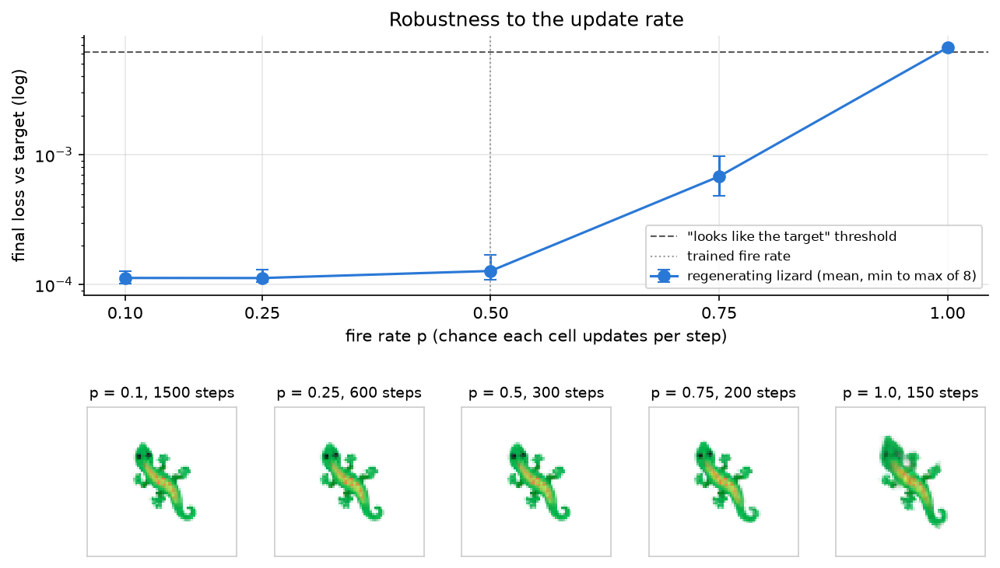
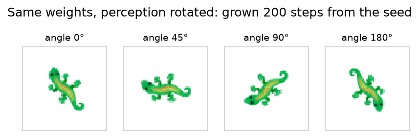
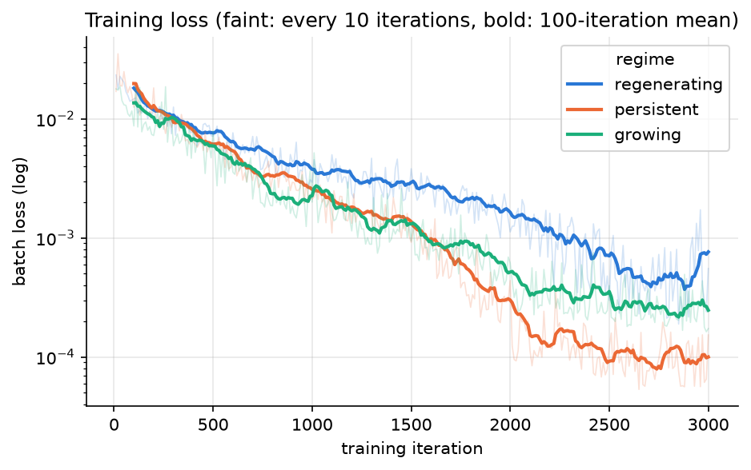
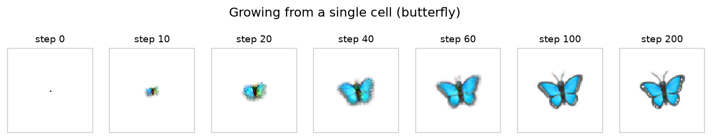
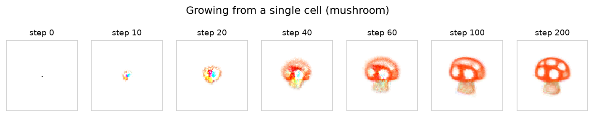

# Neural cellular automata — a lizard that grows back


## What it is

A tiny neural network that gets copied into every pixel of a 72x72 grid. Each pixel only sees itself and its neighbors and no pixel ever sees the whole image, but starting from one pixel they grow a lizard emoji together, and when you cut a hole in it, it grows back. The whole network is **8,320 weights**.

The idea isn't mine. It comes from [Growing Neural Cellular Automata](https://distill.pub/2020/growing-ca/) by Mordvintsev, Randazzo, Niklasson and Levin (Distill, 2020). What I did was rebuild it in PyTorch, train three versions of the lizard the same amount so I could compare them with real numbers, run the damage size, knockout and update rate tests, and write a browser demo from scratch in plain JavaScript where you can cut it yourself.

## Why I built it

After my [random forest digit classifier](https://github.com/menzer-david/mnist-random-forest) I started learning how neural networks actually train by building backprop from scratch following Karpathy's micrograd. I wanted a project where the neural network was the whole point and you could see it working, instead of just getting an accuracy number at the end. What got me was the idea that one tiny network copied into every pixel could build a shape and fix it, kind of like how cells in your body only talk to the cells next to them.

## How it works

1. Every pixel holds 16 numbers. The first 4 are its color and alpha (how visible it is). The other 12 are hidden numbers that don't show up in the picture and only the pixels read.
2. Every step, each pixel looks at its own 16 numbers plus two Sobel filters, which measure how each number changes left to right and top to bottom across its neighbors. That makes 48 numbers.
3. Those 48 numbers go through the same small network in every pixel (48 → 128 → 16), which outputs how much to change each of the pixel's 16 numbers.
4. Only a random half of the pixels update each step, so nothing keeps them in sync. Pixels that aren't next to anything visible get set to zero, which keeps empty space empty.
5. To train it, I start from a single seed pixel in the middle, run 64 to 96 steps, compare the colors to the 40x40 lizard, and backpropagate through all of those steps to update the weights.

I trained three versions of the lizard for 3,000 iterations each, so the comparison would be fair:

- **Growing:** every training run starts from the seed, so it only ever learns to grow.
- **Persistent:** keeps grown lizards in a pool and keeps running them, so it also has to stay a lizard after it's done growing.
- **Regenerating:** same as persistent, but it also cuts random holes in some of the lizards during training, so it practices getting damaged.

I trained on my M1 MacBook with 8 GB of RAM, using the Mac's GPU (MPS). Backpropagating through 80-ish steps at once needed about 5.5 GB and made my Mac start swapping. Gradient checkpointing fixed it by re-computing chunks of steps during the backward pass instead of storing them, which brought the peak down to about 2.2 GB. Each model took about an hour when nothing else was running, but my battery died partway through (it hibernated at 1% and picked up where it left off once I plugged it in) and it slept a couple more times overnight, so the whole thing took most of a night.

## Results

The loss is how far the grid's colors are from the lizard (mean squared error). An empty grid scores 0.030. To decide when something "looks like the lizard" I used the loss of the perfect lizard shifted over by one pixel (0.0061), since that still looks exactly the same to a person.

### Growing from one pixel



From one pixel it has a body and legs by step 40, passes the "looks like the lizard" bar by step 60, and has its eyes by step 100.

### Healing

In the GIF at the top, the lizard grows for 150 steps, then I cut a circle with a radius of 12 pixels out of its head and front legs. The loss jumps from 0.00022 to 0.015, and 150 steps later it's back down to 0.00018.

### Staying a lizard


I ran each version for 2,000 steps from the seed, 8 runs each, which is way longer than the 64 to 96 steps they trained on. The growing version looks best around step 90 and then falls apart into scattered pixels, and by step 2,000 its loss (0.043) is worse than an empty grid. The persistent and regenerating versions still look like the lizard at step 2,000 in **8 out of 8** runs.

### Cutting holes of different sizes



I grew each version for 200 steps, cut a circular hole somewhere on the lizard, and ran 300 more steps, with 20 trials for each hole size. A trial counts as healed if, at the end, its loss is within 1.5x of the same model left uncut and it still passes the "looks like the lizard" bar.

| Hole radius (px) | 3 | 6 | 9 | 12 | 15 | 18 |
|---|---|---|---|---|---|---|
| Regenerating | **95%** | **90%** | **70%** | 30% | 35% | 15% |
| Persistent | 60% | 45% | 25% | 10% | 0% | 0% |
| Growing | 5% | 0% | 0% | 0% | 5% | 0% |

The lizard is about 40 pixels across, so a radius 18 hole takes out most of it. Only the version that practiced getting damaged heals reliably, and the growing version almost never does (it falls apart even when nobody cuts it).

### Knockouts


I grew the regenerating lizard for 200 steps, wiped part of it, and ran 200 more steps, 8 runs each.

- Wipe the color but keep the hidden channels: it turns into a black silhouette and repaints itself. Healed in **8/8**.
- Wipe only the hidden channels and leave the color alone: it looks perfect at first and then fades and falls apart. Healed in **0/8**.
- Wipe the whole left half: it grows the half back. Healed in **8/8**.

So the plan for the lizard lives in the hidden channels, not in the colors you can see.

### The hidden channels



None of them look like the lizard. Most of the activity sits along the middle of the body, and a few, like channels 6 and 14, are positive on one end of the body and negative on the other. My guess is that's part of how the pixels know which end they're on, but I didn't test that.

### Changing the update rate



In training, each pixel had a 50% chance of updating each step. I tried other rates and changed the number of steps so every pixel gets about 150 updates on average. From 0.1 to 0.5 it's basically the same, at 0.75 it's a bit worse but still the lizard, and at 1.0, where every pixel updates every step (which it never saw in training), it comes out smudged and doesn't look like the lizard in any of the 8 runs.

### Rotating what the pixels see



Same weights, but I rotated the Sobel filters, which changes which direction the pixels think is "right" and "down". The lizard grows rotated by the same angle.

### Training curves



These three losses aren't directly comparable, because each version builds its training batches differently (the regenerating one keeps getting fresh holes), so the regenerating one ending highest doesn't mean it's the worst.

### A butterfly and a mushroom





I also trained a butterfly and a mushroom the regenerating way to make sure it wasn't just a lizard thing. My first try only gave them 2,000 iterations, and when I left them running they slowly fell apart (the butterfly drifted up the grid and the mushroom's stem turned into fuzz). That's because the learning rate drops at iteration 2,000, so they stopped right before the fine-tuning part. With 3,000 iterations like the lizards they hold their shape. The mushroom still comes out a little grainy, especially the stem.

## Try the demo

Open `demo/index.html` in a browser (double-clicking it works, no server needed) and drag across the lizard to cut it. You can switch to the butterfly or the mushroom, or to the persistent and growing lizards to watch them fail to heal, reset it, and change the brush size, speed and rotation. It runs in plain JavaScript with no libraries, and `demo/parity_test.mjs` checks that it matches the PyTorch model to within 0.0000005.

## How to run it

Needs Python 3 with `torch`, `numpy`, `pillow`, and `matplotlib`, plus Node if you want to run the parity check. The trained checkpoints are included, so you don't have to retrain anything.

```
pip install -r requirements.txt
python3 test_nca.py          # quick self-check
python3 nca.py train --target lizard --regime regenerating --iters 3000 --out checkpoints/lizard.pt
bash train_all.sh            # trains every model, one at a time, on the Mac's GPU
python3 experiments.py       # remakes every figure and results.json
python3 nca.py export        # writes the demo weights
node demo/parity_test.mjs    # checks the JavaScript matches Python
```

`experiments.py` takes a few minutes on CPU. You can also train it on your own image by putting a transparent PNG in `targets/` and passing `--target <name>`. It works best on simple, bold shapes like emoji, since it gets shrunk down to 40x40.

## What I learned

The biggest thing I learned is that what a model can do depends a lot on what you train it on. All three lizards have the same network and got the same amount of training, but they act completely differently, and only the one that practiced getting damaged can really heal. The knockout test showed me that the hidden channels work like the lizard's memory or instructions. Backprop through 80 steps turned out to be the same chain rule I built in micrograd, just repeated a lot, but memory became the real problem, which is how I learned about gradient checkpointing. I also learned that training on a laptop takes a lot of patience, so keep the charger plugged in.

## Credits

- The method is from [Growing Neural Cellular Automata](https://distill.pub/2020/growing-ca/) by Mordvintsev, Randazzo, Niklasson and Levin (Distill, 2020).
- The emoji images are from Google's [Noto Emoji](https://github.com/googlefonts/noto-emoji). Their license is in `targets/LICENSE`.
